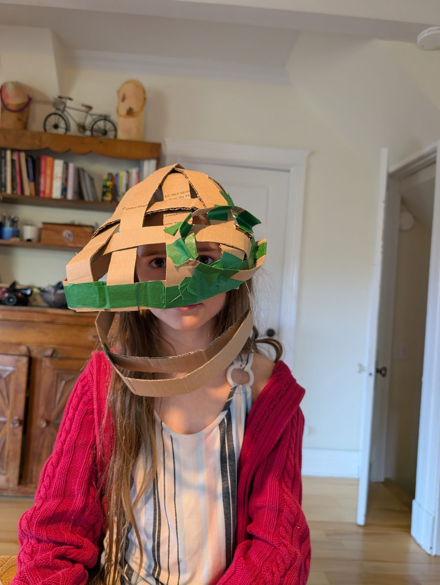
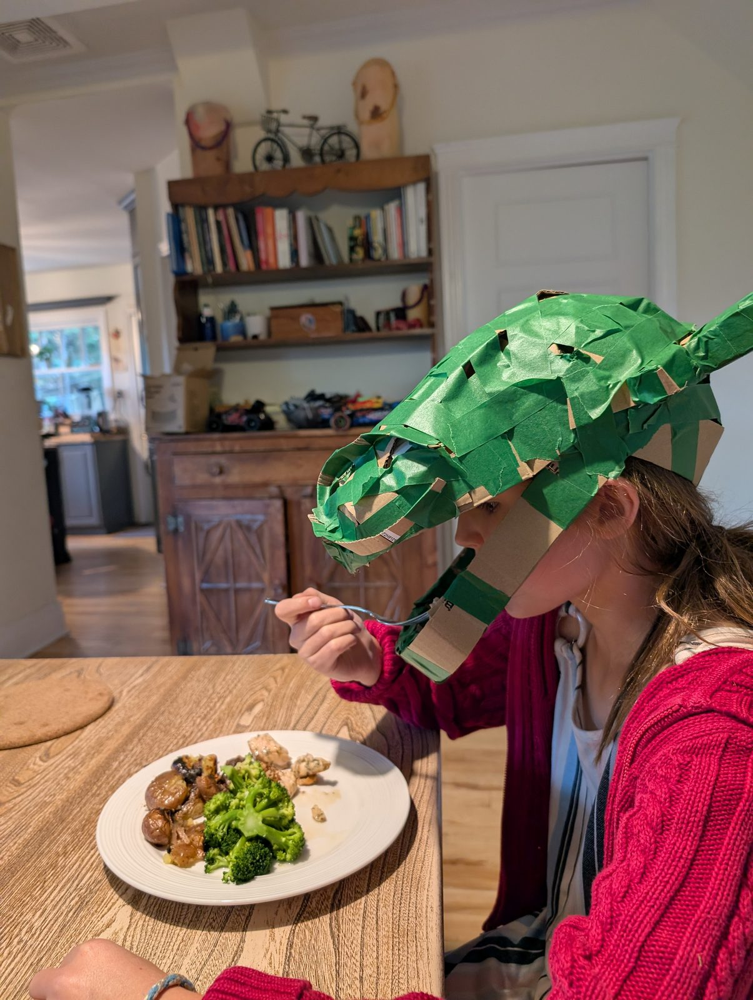
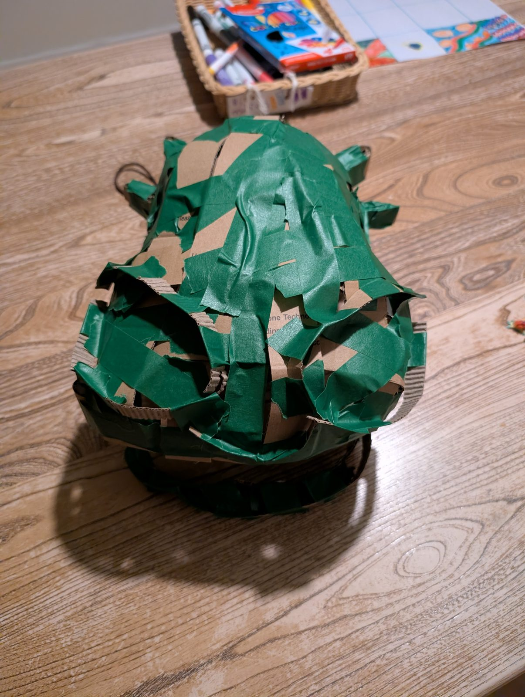
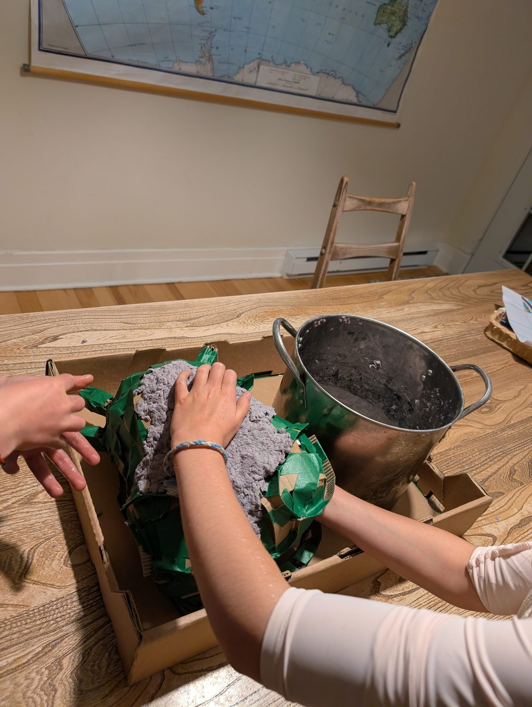
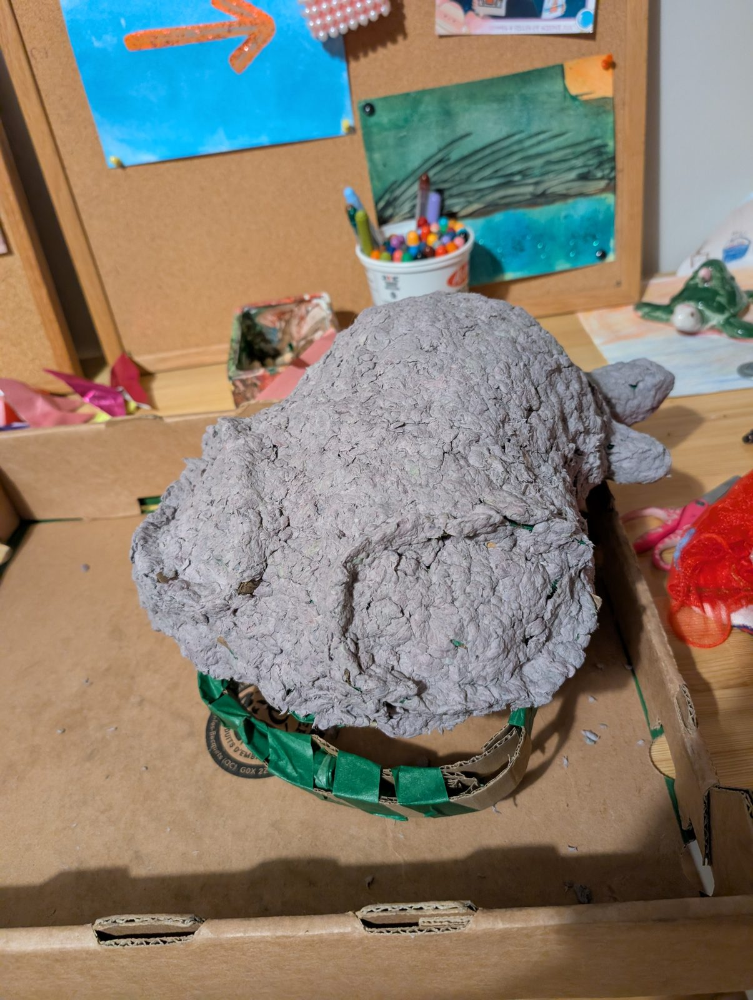
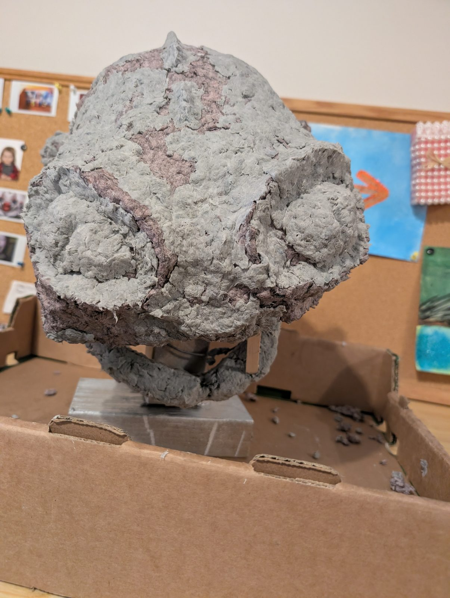
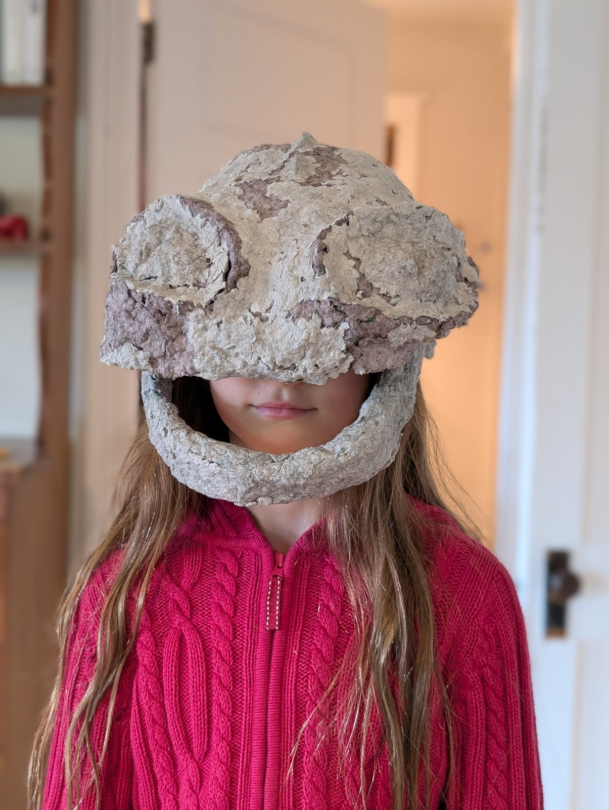
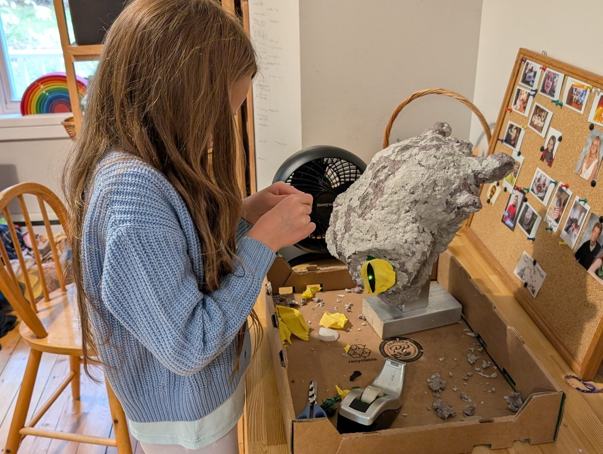
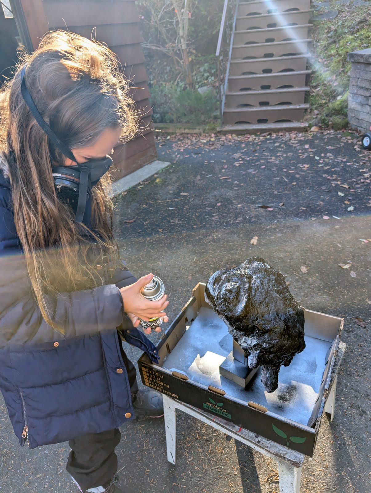
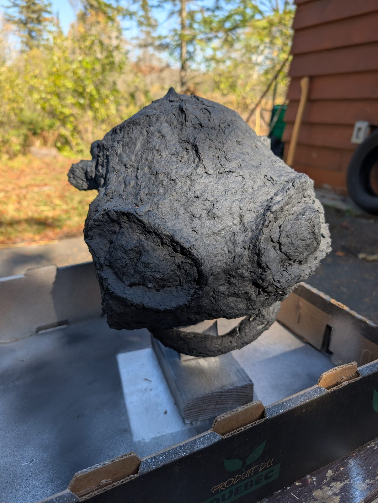

This year we went possibly a bit overboard with our costumes! But it was one of the most rewarding projects of the year. I'd had grand plans last year, but life got in the way and I wasn't able to invest as much time as I'd have liked. As luck would have it, this year was *also* busy, with a lot of travelling for work, which meant we had to start planning and building in early September to get them all done by Halloween.

L was Toothless from *How to Train Your Dragon* and E was The Mandalorian.



L's costume was fully custom, with a papier-mâché mask, animatronic wings, and a cable-controlled tail.

E's costume was 3D printed at home, and properly sized to fit his body. He also sanded, painted, and filled in print blemishes himself.



## Toothless' mask
The mask was made using a papier-mâché method I'd never tried before, which I've seen called "[paper clay](https://www.ultimatepapermache.com/paper-mache-clay)" and "[papier-mâché pulp](https://www.instructables.com/Make-paper-mache-pulp/)" in different places.

We started with a cardboard frame that went through thorough usability testing to make sure she could still eat Halloween candy with her mask on.



The first layer of papier-mâché was very hard to apply, and because of the painter's tape we'd used, it was a bit frustrating to keep everything stuck together until it dried. If I were to do this again, I'd use a much thinner first layer, and not worry about gaps, as these were very easy to fill in with a second batch of papier-mâché later.















## Toothless' tail

The tail was a lot of fun to iterate on and build. At first we wanted a fully animatronic tail that L would be able to control with a switch, but we ran out of time. Instead, we ended up with a tail that she could control with some cables, like a puppeteer. If we use this costume for something else, I might take the time to add some motors to this so it can move independently.

We started by looking through the garage for stuff that might work as the tail structure, and we found this threaded hose that was meant for a fountain. It was the perfect diameter and stiffness and it had a great natural "sway" to it.



As a first test, we threaded some fishing line directly between the ribs, which gave some nice motion when pulled, but you needed a lot of force for this to work. 



The rubber that the hose was made of had too much friction, so I asked Claude Opus 5.5 to design me some "vertebrae" with small holes in them which could thread directly onto the hose.

This was my first time getting Claude to design a physical object, and it came out great! It gave me a parametric OpenSCAD file with different modes which allowed me to print out a single test vertebra to make sure the thread pitch was correct.

```
Help me design the ribs for the tail I'm building. It's on a hose for a fountain. There are ribs around it in a screw shape. the inner diameter is 19mm, rib diameter 24mm, and the distance between ribs is 6mm.
```
{: .wrap}



I then printed out 12 of them, tapering in size so the tail would have a nice natural movement.



I think to make the tail properly animatronic, the next step would be to attach a servo motor to the cables, which would shorten or lengthen them, giving the swaying motion.

## Toothless' wings

These were less exciting to build, as we reused the animatronic wing armature I'd made for a previous Halloween, when L was an eagle, and just swapped the feathers for dragon wings. The wings are driven by servo motors, controlled by an Arduino.



## Mandalorian

Mando was also a tonne of fun to make with E! We found a great collection of parts on [MakerWorld](https://makerworld.com/en/models/2816918-wearable-cosplay-mandalorian-armor-all-parts?from=search#profileId-3136263), which we sized to his body with [bodydbl](https://bodydbl.com/). When printing out the helmet, a few layers didn't adhere properly, so we filled the holes with epoxy and sanded everything with 240 grit sandpaper to make it really smooth.





For all the other parts, we had fun removing all the supports and making little forests out of them.

Even after we'd sized the parts using bodydbl, some of them still didn't fit quite right, so we modified them with an X-Acto knife, or re-sized them and re-printed them.



He made his own bullets with duct tape stuck to a belt.




## Thoughts

We got a lot of fist bumps while out trick or treating, but even if we hadn't gone out on Halloween, this would still have been a worthwhile project. There was a bunch of planning, trying, measuring, thinking, breaking, and all manner of joking around that wouldn't have happened without it. Project times are always good times!
